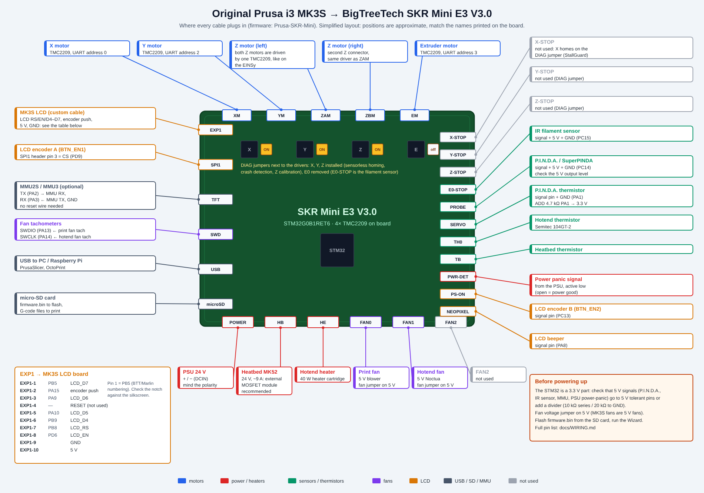
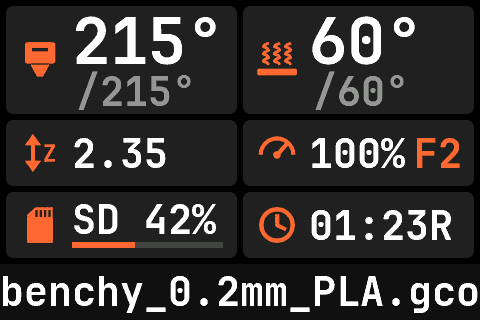
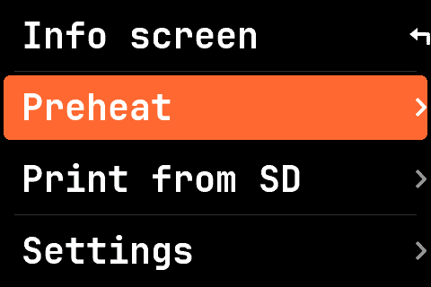
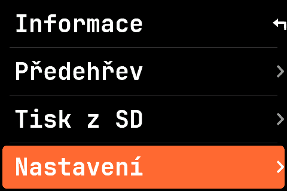
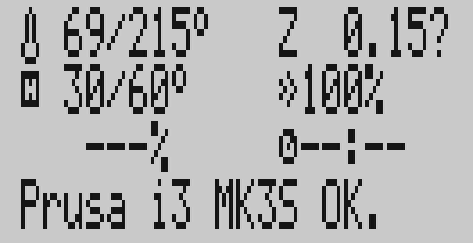

# Wiring an Original Prusa i3 MK3S to the SKR Mini E3 V3.0

The pin map below is the one compiled into the firmware
(`Firmware/pins_SKR_MINI_E3_V3.h`). Change it there if you wire things differently.

The picture is a simplified layout ([SVG](wiring.svg), generated by
`tools/wiring_diagram.py`): connector positions are approximate, go by the names
printed on the board.

Checked against the BIGTREETECH schematic and pin diagram of the V3.0 board
([hardware files](https://github.com/bigtreetech/BIGTREETECH-SKR-mini-E3/tree/master/hardware/BTT%20SKR%20MINI%20E3%20V3.0/Hardware)).

> **Fans: the SKR fan outputs are 24 V.** FAN0/FAN1/FAN2 have the input voltage on
> their + pin and a low-side MOSFET on their − pin; there is **no 5 V fan jumper** on the
> V3.0. The MK3S fans are 5 V fans: connecting them to the + pin destroys them. Connect
> the fan **+ (red) to a 5 V pin** and only the fan **− (black) to the FAN − pin**, see
> below.

> **Signal levels.** The STM32G0B1 is a 3.3 V part, the MK3S sensors were made for the
> 5 V EINSy. The board supplies the sensors with 5 V (E0-STOP: fixed 5 V; Z-PROBE: the
> "PWR" rail, 5 V with the default jumper), and its inputs have no level shifters, only
> ESD protection rated for 3.3 V. Keep the sensors on 5 V (they are specified for it)
> and protect each 5 V signal:
>
> - **P.I.N.D.A., IR filament sensor, power panic**: a **Schottky diode** in the signal
>   wire (BAT85, BAT43, 1N5817 or similar), **cathode (band) toward the sensor**. The
>   sensor pulls the input low through the diode, the high level comes from the 3.3 V
>   pull-up on the board side (10 kΩ on E0-STOP, the MCU pull-up on PROBE and PWR-DET,
>   enabled by the firmware). Works with open-collector and push-pull outputs, no 5 V
>   reaches the STM32.
> - **MMU serial (MMU TX → SKR RX)**: a divider, **1 kΩ in series and 2 kΩ to GND** at
>   the SKR side (5 V → 3.3 V). The other direction (SKR TX → MMU RX) needs nothing:
>   3.3 V is a valid high level for the 5 V MMU board.
> - Fan tachometers, thermistors, encoder and display: nothing needed.
>
> If you prefer to measure: power the sensor from the board and measure its signal wire
> (not connected to the board) against GND in both states. 0 V / open in both states =
> open collector, no diode needed. ~5 V in one state = use the diode.

## Board jumpers

| Jumper | Setting | Why |
|---|---|---|
| DIAG X, Y, Z (next to the drivers) | **installed** | StallGuard output of the TMC2209 to X-STOP/Y-STOP/Z-STOP: sensorless homing, Z calibration (no crash detection: X/Y print in spreadCycle) |
| DIAG E0 | **removed** | E0-STOP is used by the filament sensor |
| Neo-PWR (next to the Neopixel header) | **onboard 5 V** (default) | "PWR" rail = 5 V for the Z-PROBE, TFT and Neopixel headers |

There is no fan voltage jumper on the V3.0 (see the fan note above).

## Motors, heaters, thermistors

| MK3S part | SKR header | MCU pin | Notes |
|---|---|---|---|
| X motor | XM | PB13/PB12/PB14 (step/dir/en) | TMC2209, UART address 0 |
| Y motor | YM | PB10/PB2/PB11 | TMC2209, UART address 2 |
| Z motors (both, in parallel as on the EINSy) | ZAM / ZBM | PB0/PC5/PB1 | TMC2209, UART address 1 |
| Extruder motor | EM | PB3/PB4/PD1 | TMC2209, UART address 3 |
| Hotend heater (40 W) | HE | PC8 | |
| Heatbed MK52 | HB | PC9 | 24 V, ~9 A. An external MOSFET module is recommended |
| Hotend thermistor (Semitec 104GT-2) | TH0 | PA0 | 4.7 kΩ pull-up on the board |
| Heatbed thermistor | TB | PC4 | 4.7 kΩ pull-up on the board |

If an axis moves the wrong way, flip `INVERT_?_DIR` in
`Firmware/variants/MK3S-SKR_MINI_E3_V3.h` (the coil order of the motor connectors
may differ from the EINSy).

## P.I.N.D.A., filament sensor, fans, power panic

| MK3S part | SKR header | MCU pin | Notes |
|---|---|---|---|
| P.I.N.D.A. signal | Z-PROBE header: PROBE pin (signal), PWR (5 V), GND | PC14 | through a Schottky diode, cathode toward the P.I.N.D.A. (see above) |
| P.I.N.D.A. thermistor (PINDA v2) | Z-PROBE header: SERVOS pin, GND | PA1 | **add a 4.7 kΩ resistor from PA1 to 3.3 V** (3.3 V: pin 7 of the SPI1 header). Without a thermistor (SuperPINDA) remove `PINDA_THERMISTOR` from the pin file |
| IR filament sensor output | E0-STOP (signal), +5 V, GND | PC15 | through a Schottky diode, cathode toward the sensor |
| Print fan (5 V blower) | **+ to 5 V**, − to FAN0 − | PC6 | **not** to FAN0 + (24 V) |
| Hotend fan (5 V Noctua) | **+ to 5 V**, − to FAN1 − | PC7 | **not** to FAN1 + (24 V) |
| Print fan tachometer | SWD header, SWDIO | PA13 | internal pull-up. No debugger can be used while connected |
| Hotend fan tachometer | SWD header, SWCLK | PA14 | internal pull-up |
| PSU power-panic signal | PWR-DET (signal, GND) | PC12 | active low, internal pull-up (unconnected = power good); Schottky diode, cathode toward the PSU |
| MMU2S/MMU3 serial | TFT header | PA2 = TX → MMU RX, PA3 = RX ← MMU TX | 115200 Bd. MMU TX → PA3 through the 1 kΩ / 2 kΩ divider. The MMU is reset over the protocol: do **not** connect the MMU reset wire to the TFT header "RST" pin, that is the reset of the SKR |

5 V for the fans: the +5 V pin of EXP1, E0-STOP, Neopixel ("PWR") or TFT header; the fans
draw about 0.2 A together, the onboard 5 V regulator supplies up to 3 A. The tachometer
wires (yellow) go to the SWD header as listed; they are open collector, no resistor.

## Display: color TFT (default)

The default build drives a 480x320 color TFT with the **ST7796S** controller over SPI,
plus a rotary encoder and a buzzer. The Prusa menus are the same as on the MK3S, drawn
in a modern dark style; the status screen is a dashboard:

| Status screen | Menu | Translated menu |
|---|---|---|
|  |  |  |

(Pictures from the host test of the driver, `test/tft/run.sh`.)

### Parts

| Part | Example (Amazon) | Notes |
|---|---|---|
| 4.0" 480x320 SPI TFT, ST7796S | [Hosyond 4.0" ST7796S SPI module](https://www.amazon.com/dp/B0CKRJ81B5) | any 480x320 ST7796S SPI module works, e.g. 3.5" ones; the touch screen and its SD slot are not used |
| KY-040 rotary encoder with push button | [Taiss KY-040, 5 pcs](https://www.amazon.com/dp/B07F26CT6B) | |
| KY-006 passive piezo buzzer module | [KY-006, 3 pcs](https://www.amazon.com/dp/B07MV55Z6Q) | a *passive* buzzer (the firmware plays tones). Avoid "low level trigger" transistor modules: they draw current while silent |
| female-female jumper wires | | 15-20 cm |

### Wiring

| Display pin | SKR header / pin | MCU pin |
|---|---|---|
| VCC | EXP1-10 (5 V) | |
| GND | EXP1-9 | |
| CS | EXP1-8 | PD6 |
| RESET | PS-ON header, signal pin | PC13 |
| DC/RS | EXP1-6 | PB9 |
| SDI (MOSI) | EXP1-5 | PA10 (SPI2) |
| SCK | EXP1-7 | PB8 (SPI2) |
| LED (backlight) | SPI1 header pin 3 | PD9 |
| SDO (MISO), T_* (touch) | not connected | |

| Encoder (KY-040) pin | SKR header / pin | MCU pin |
|---|---|---|
| CLK | EXP1-1 | PB5 |
| DT | EXP1-3 | PA9 |
| SW | EXP1-2 | PA15 |
| + / GND | **3.3 V** (SPI1 header pin 7) / GND | the KY-040 pull-ups then pull to 3.3 V |

| Buzzer (KY-006) pin | SKR header / pin | MCU pin |
|---|---|---|
| S | NEOPIXEL header, signal pin | PA8 |
| − | NEOPIXEL header, GND | |

The display module has its own 3.3 V regulator and 3.3 V logic, so it connects
directly: no resistors anywhere in the display, encoder or buzzer wiring. The Neopixel
output is buffered to 5 V on the board (74LVC1G125), which drives the buzzer directly.

**EXP1 pin numbers.** This document uses the BTT/Marlin numbering of the pin diagram
(1 = PB5 … 10 = +5 V). The schematic numbers the same header the other way round
(J10 pin 1 = 5 V), and the triangle on the board may follow either. Go by the signal
names, and before connecting the display, measure with the board powered over USB:
+5 V and GND are the pair at one end of the header, PB5/PA15 at the other end. EXP1 pin numbers: 1 = PB5, 2 = PA15, 3 = PA9, 4 = RESET (not used),
5 = PA10, 6 = PB9, 7 = PB8, 8 = PD6, 9 = GND, 10 = 5 V (BTT/Marlin numbering, check
the notch against the silkscreen).

### If the picture is not right

ST7796S modules differ in the panel orientation, the color order and (IPS panels) the
color inversion. Build with one of these options (for example
`PLATFORMIO_BUILD_FLAGS="-DTFT_MADCTL=0xE8" pio run`):

| What you see | Option |
|---|---|
| upside down | `-DTFT_MADCTL=0xE8` |
| orange shows as blue | `-DTFT_MADCTL=0x20` (or `0xE0` when also upside down) |
| white background, colors inverted | `-DTFT_INVERT=1` |
| garbage or flickering with long wires | `-DTFT_SPI_BR=2` (8 MHz SPI clock instead of 16 MHz) |
| knob turns the wrong way | swap `BTN_EN1` / `BTN_EN2` in `Firmware/pins_SKR_MINI_E3_V3.h` |

## Alternative: Creality Ender-3 display (`-DLCD_ENDER3`)

With `-DLCD_ENDER3` the firmware drives the stock Creality Ender-3 display (128x64, ST7920 controller,
the "12864" display of the Ender-3 / Ender-3 Pro / CR-10, and its clones sold as
"Ender-3 LCD12864"). Plug it into **EXP1** with the 10-pin ribbon cable that comes with
it; the display, the knob, the knob push button and the beeper all run over that
cable, nothing else to wire. Use the display's EXP3 connector (the one the Ender-3
board plugs into).

The Prusa menus are shown exactly as on the MK3S: 4 lines of 20 characters, drawn in
the HD44780 font of the original LCD.

 The display does not fit the MK3S LCD bracket,
print a mount for it.

| Display signal | EXP1 pin | MCU pin |
|---|---|---|
| Beeper | 1 | PB5 |
| Knob push (BTN_ENC) | 2 | PA15 |
| Knob B (BTN_EN2) | 3 | PA9 |
| Knob A (BTN_EN1) | 5 | PA10 |
| ST7920 SCLK ("D4") | 6 | PB9 |
| ST7920 CS ("RS") | 7 | PB8 |
| ST7920 SID ("EN") | 8 | PD6 |
| GND / 5 V | 9 / 10 | |

If turning the knob clockwise moves *up* in the menus, swap the `BTN_EN1` and
`BTN_EN2` lines in `Firmware/pins_SKR_MINI_E3_V3.h`.

EXP1 pin numbers follow the BigTreeTech numbering used by Marlin
(`pins_BTT_SKR_MINI_E3_V3_0.h`): 1 = PB5, 2 = PA15, 3 = PA9, 4 = RESET, 5 = PA10,
6 = PB9, 7 = PB8, 8 = PD6, 9 = GND, 10 = 5 V.

The SPI1, PS-ON and NEOPIXEL headers stay free with this display.

## Alternative: original MK3S 20x4 LCD (custom cable)

Build with `-DLCD_MK3S` (for example `PLATFORMIO_BUILD_FLAGS=-DLCD_MK3S pio run`).
The MK3S LCD board uses two 10-pin cables (EXP1, EXP2) like the RepRapDiscount Smart
Controller. The SKR Mini E3 V3 has one EXP1 header, so a custom harness is needed.
The micro-SD slot of the LCD is not used (use the slot on the SKR).

| LCD signal | SKR header / pin | MCU pin |
|---|---|---|
| LCD_RS | EXP1-7 | PB8 |
| LCD_EN | EXP1-8 | PD6 |
| LCD_D4 | EXP1-6 | PB9 |
| LCD_D5 | EXP1-5 | PA10 |
| LCD_D6 | EXP1-3 | PA9 |
| LCD_D7 | EXP1-1 | PB5 |
| BTN_ENC (encoder push) | EXP1-2 | PA15 |
| BTN_EN1 (encoder A) | SPI1 header pin 3 (CS) | PD9 |
| BTN_EN2 (encoder B) | PS-ON header signal | PC13 |
| BEEPER | NEOPIXEL header signal | PA8 |
| 5 V / GND | EXP1-10 / EXP1-9 | |

## Pins that are used by the firmware internally

| Function | MCU pins |
|---|---|
| USB (host serial) | PA11/PA12 |
| TMC2209 UART | PC10 (TX) / PC11 (RX) |
| AT24C32 EEPROM (settings) | PB6 (SCL) / PB7 (SDA) |
| micro-SD card | PA4 (CS), PA5/PA6/PA7 (SPI1), PC3 (detect) |
| status LED | PD8 |
