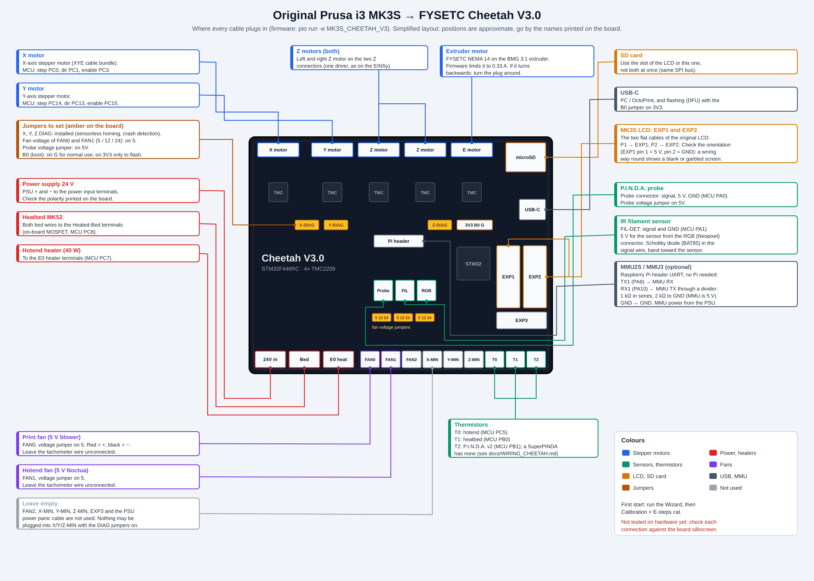

# Wiring an Original Prusa i3 MK3S to the FYSETC Cheetah V3.0

Build: `pio run -e MK3S_CHEETAH_V3` (English only). The pin map is
`Firmware/pins_FYSETC_CHEETAH_V3.h`, checked against the FYSETC schematic
([Cheetah_V3.0 hardware files](https://github.com/FYSETC/Cheetah_V3.0/tree/main/Hardware)).
The board marks every pin name on its back side: go by those names.



(Vector version: [wiring_cheetah.svg](wiring_cheetah.svg), generated by
`tools/wiring_diagram_cheetah.py`. The layout is simplified: go by the names printed on
the board.)

## What works, and what does not

The Cheetah V3 uses all 51 I/O pins of its STM32F446RC for its own connectors. Only the
two pins of the UART on the Raspberry Pi header (TX1 = PA9, RX1 = PA10) are left: they
carry the MMU2S/MMU3. Power panic and the fan check (fan RPM, Noctua/alt-fan detection)
are not used.

Everything else of the MK3S firmware works as on the SKR Mini port: original LCD menus
(English), its SD card slot, P.I.N.D.A. with temperature compensation, XYZ / Z / first
layer calibration, crash detection and sensorless homing, IR filament sensor, input
shaper and pressure advance (MK3.5 motion), thermal model.

Not available: other languages (the 256 KiB flash holds only English), power panic
(a power loss ends the print), the fan check (the fans run, their RPM is not checked;
the self test asks on the LCD whether each fan spins),
LCD backlight dimming.

Menus: the same as on the MK3S (checked in the emulator), including Settings > Mode
[Normal/Stealth] and Settings > MMU [On/Off]. Not in the menus: Language, RPi port,
Brightness, Fans check, Lin. correction (the TMC2209 has no microstep table), Belt test,
Belt status and the memory dump items.
Added: Settings > HW Setup > E-steps and Calibration > E-steps cal. (see Extruder).
Added: Calibration > Homing sensitivity: StallGuard thresholds of the sensorless homing of
X, Y and Z (higher = more sensitive; raise it if an axis bounces or grinds at the end before
it stops, lower it if it stops early), with Home X / Home Y to try the value. Stored at once.
Added: Settings > Input shaper, PA: shaper type and frequency of X and Y and the pressure
advance, with test prints to find the values: see [TUNING.md](TUNING.md).

## Extruder (BMG gears 3:1, FYSETC NEMA 14 pancake motor)

The defaults are set for a custom extruder with BMG gears and the FYSETC NEMA 14 pancake
motor, not for the original MK3S extruder:

| Setting | Value | Original MK3S |
|---|---|---|
| E steps/mm (M92 E) | 415 | 280 |
| E microsteps (M350 E) | 16 | 32 |
| E motor current, running | 0.33 A RMS (Prusa units 17) | 0.56 A (30) |
| E motor current, holding | 0.20 A RMS (10) | 0.56 A (30) |

FYSETC specifies 0.30-0.35 A for this motor; it overheats above that. Do not raise the E
current with M911/M912 above 18 (0.34 A), and leave the "E-cool mode" of the
Experimental menu off (it drives the extruder with a fixed voltage instead of the
current setting).

Calibrate the steps after the first start with **Calibration > E-steps cal.** on the
LCD: it heats the nozzle (temperature to choose), asks to mark the filament 120 mm above
the top of the extruder, extrudes 100 mm, asks for the distance left from the mark to the
extruder and computes, shows and saves the new value. Run it twice to check. The value
can also be set by hand in **Settings > HW Setup > E-steps**, or over USB with
`M92 E<steps>` and `M500`. If the filament moves backwards,
reverse the motor: turn its plug around or swap the two wires of one coil (or set
`INVERT_E0_DIR` to 1 in `Firmware/variants/MK3S-CHEETAH_V3.h`).

## Board jumpers

| Jumper | Setting | Why |
|---|---|---|
| X, Y, Z DIAG (JP3, JP4, JP5, next to X-min/Y-min/Z-min) | **installed** | StallGuard of the TMC2209 to the X/Y/Z-min inputs: sensorless homing, crash detection, Z calibration. Leave the X-min/Y-min/Z-min connectors empty |
| FAN0 voltage (JP2) | **5V** | MK3S print fan (5 V blower) |
| FAN1 voltage (JP1) | **5V** | MK3S hotend fan (5 V Noctua) |
| Probe voltage (JP8) | **5V** | P.I.N.D.A. / SuperPINDA |
| BT0 | **GND** (normal operation) | 3V3 only to flash the firmware, see below |

## Connections

| MK3S part | Cheetah connector | MCU pin | Notes |
|---|---|---|---|
| X motor | X | PC0/PC1/PC3 (step/dir/en) | TMC2209 |
| Y motor | Y | PC14/PC13/PC15 | |
| Z motors (both) | Z (two connectors) | PB4/PB5/PC2 | both on the one driver, as on the EINSy |
| Extruder motor | E | PB2/PA15/PD2 | |
| Hotend heater (40 W) | E0 heater | PC7 | |
| Heatbed MK52 | Heated-Bed | PC8 | on-board MOSFET, 15 A fuse |
| Hotend thermistor | T0 | PC5 | 4.7 kΩ pull-up on the board |
| Heatbed thermistor | T1 | PB0 | |
| P.I.N.D.A. thermistor (PINDA v2) | T2 | PB1 | pull-up on the board, no extra resistor. SuperPINDA (no thermistor): remove `PINDA_THERMISTOR` from the pin file |
| P.I.N.D.A. signal / 5 V / GND | Probe (signal pin, power pin, GND) | PA0 | the board has a BAT85 diode in the signal line: 5 V sensors are safe |
| IR filament sensor | FIL-DET (signal, GND); 5 V from the Neopixel header | PA1 | FIL-DET's own power pin is 3.3 V. Put a Schottky diode (BAT85/BAT43) in the signal wire, band toward the sensor (3.3 V pull-up on the board) |
| Print fan (5 V) | FAN0 | PA14 | JP2 on 5V. The tachometer wire stays unconnected |
| Hotend fan (5 V) | FAN1 | PA13 | JP1 on 5V. The tachometer wire stays unconnected |
| MK3S LCD | EXP1 + EXP2, the two LCD cables | see the pin file | RepRapDiscount layout like the EINSy. Check the orientation: EXP1 pins 1/2 are 5 V/GND |
| PSU power panic cable | not connected | | not used |
| MMU2S / MMU3 | Pi header: TX1 (PA9) → MMU RX, RX1 (PA10) ← MMU TX, GND | PA9/PA10 | 115200 Bd. MMU TX → RX1 through a divider (1 kΩ in series, 2 kΩ to GND): the MMU board is 5 V. No reset wire (reset over the protocol) |

micro SD: the on-board TF slot and the SD slot of the MK3S LCD share the same SPI bus,
chip select and card detect. Use one of them, not both at once.

The MCU debug pins (SWDIO/SWCLK) drive FAN1/FAN0: a debugger can not be used.

## Flashing

The firmware is flashed over USB (DFU mode of the STM32). The settings (calibration,
Live Z, statistics) live in flash sectors 1 and 2, between the two parts of the
firmware. The build writes images that leave them alone
(`.pio/build/MK3S_CHEETAH_V3/`):

- `firmware.hex` for STM32CubeProgrammer (USB/DFU), or
- `firmware_0x08000000.bin` and `firmware_0x0800C000.bin` for dfu-util.

Do not flash `firmware.bin`: it spans the settings sectors and would erase them.

1. Power off, set the BT0 jumper to 3V3, connect USB, power on (12/24 V).
2. Flash, e.g. with dfu-util:
   ```
   dfu-util -a 0 -s 0x08000000 -D firmware_0x08000000.bin
   dfu-util -a 0 -s 0x0800C000:leave -D firmware_0x0800C000.bin
   ```
3. Power off, set BT0 back to GND, power on.

On the first start the settings are empty: the printer starts like a new MK3S, run the
**Wizard** (self test, XYZ calibration, first layer calibration).

Status line messages of the driver supervision:

- **TMC drivers offline**: the drivers do not answer, normally because the board runs from
  USB with the 12/24 V supply off. The firmware checks every second and configures the
  drivers as soon as they answer ("TMC drivers ready").
- **TMC address error**: the drivers answer, but their addresses could not be told apart
  (the default assignment is used). Check the serial log.
- **TMC write error**: a driver did not take a setting after three attempts (wiring or
  noise on the UART line). The serial log names the axis and register.

At start-up the firmware finds out which TMC2209 UART address belongs to which axis
(FYSETC's documents disagree on the straps) and prints it:
`TMC2209 UART addresses X0 Y2 Z1 E3`.
